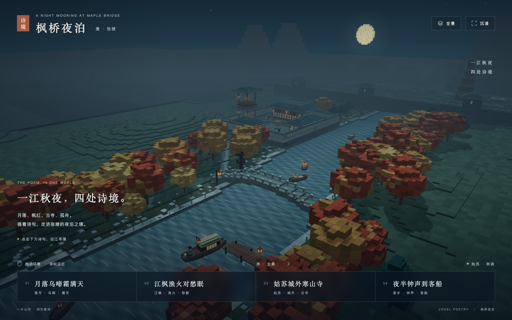
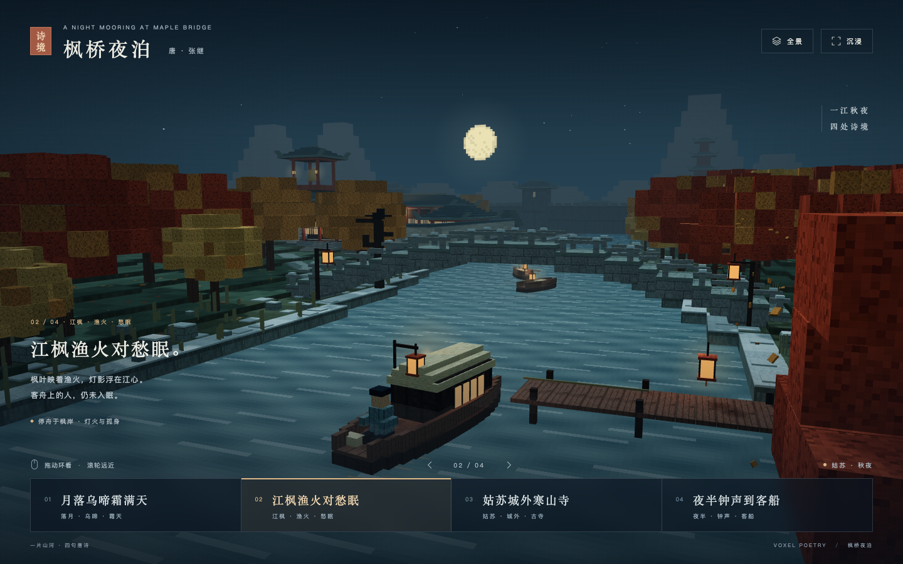
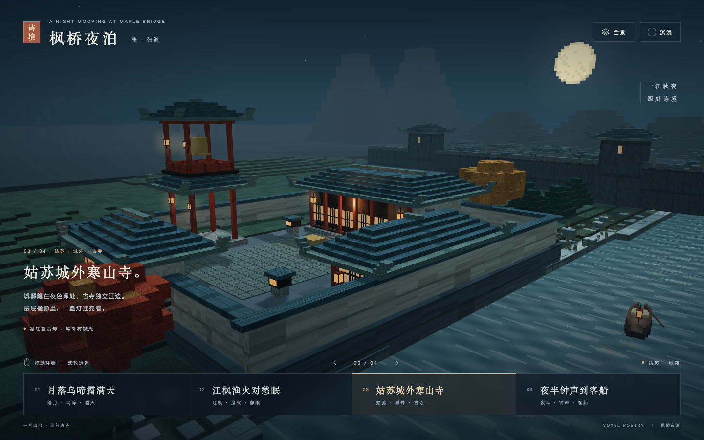
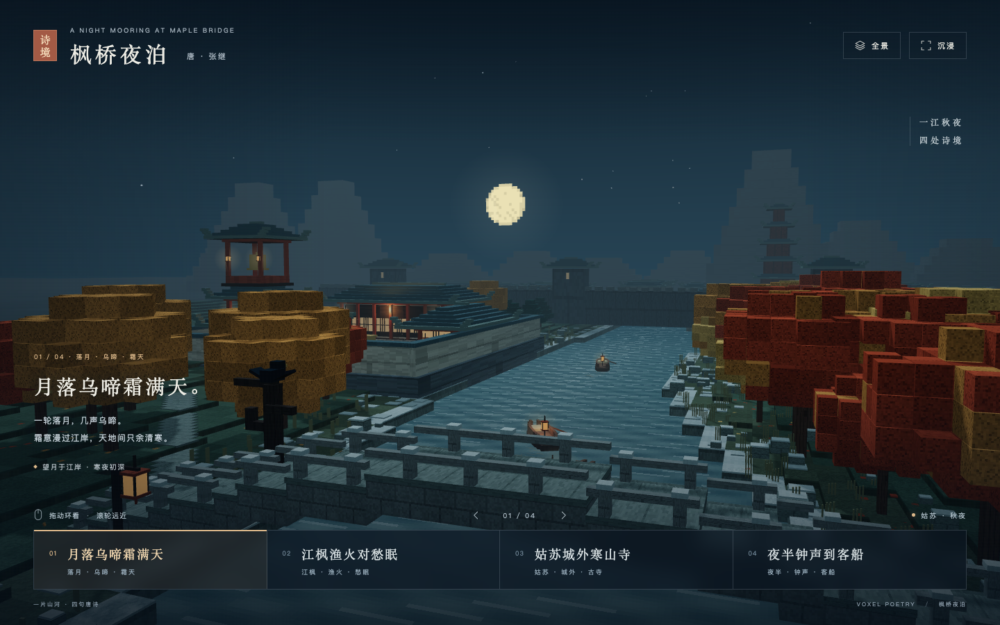
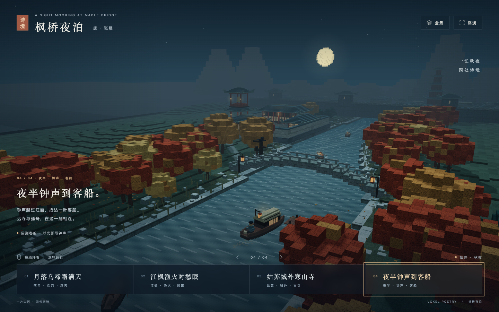

# 枫桥夜泊

把张继的《枫桥夜泊》化作一片可自由环看的 3D 像素江南秋夜。四句诗对应四处诗境，江流、枫桥、客船、寒山寺与远城始终处在同一个世界里。



## 四处诗境

| 诗句 | 景观与意蕴 |
| --- | --- |
| 月落乌啼霜满天 | 低垂的像素月亮、枯枝上的乌鸦、薄霜江岸与寒雾，表现秋夜清寒。 |
| 江枫渔火对愁眠 | 红褐枫林、渔舟灯火与江面倒影，客船上的旅人独坐未眠。 |
| 姑苏城外寒山寺 | 山门、院落、殿宇与两层钟楼，城墙屋舍隐在寺后的夜色里。 |
| 夜半钟声到客船 | 回望客船与远寺，铜钟摆动，淡淡光晕越过江面，用视觉表达钟声抵达。 |

| 江枫与客船 | 城外寒山寺 |
| --- | --- |
|  |  |

| 月落与霜天 | 钟声到客船 |
| --- | --- |
|  |  |

上述图片均来自网页实际运行画面。建筑与空间为诗意化创作。

## 操作

- 点击四句诗：镜头沿江飞向对应景观；“全景”返回整片江景。
- 鼠标拖动旋转、滚轮缩放；触屏单指旋转、双指缩放。
- 拖动或滚轮立即停止导览；快速选择多个诗境，以最后一个选择为准。
- 上一句、下一句在全景与四句诗之间循环；键盘 `1–4` 选择诗句、`0` 返回全景，左右方向键切换。
- “沉浸”隐藏界面；`Esc` 或“显示界面”恢复。
- 遵循系统“减少动态效果”：镜头直接抵达，水面、落叶、乌鸦、船与钟声光晕保持静止。

作品仅包含视觉，无音频。

## 本地运行

需要 Node.js 22.12 或更新版本、pnpm，以及支持 WebGL 2 的现代浏览器。

```sh
pnpm install
pnpm dev
```

打开终端显示的本地地址，默认是 `http://localhost:5173`。

```sh
pnpm check   # TypeScript 检查
pnpm build   # 检查并生成 dist/
pnpm preview # 预览生产构建，默认 localhost:4173
```

`dist/` 可由静态服务器托管。生产运行资源全部随构建打包，场景不依赖外部模型、图片、字体服务或音频。

## 实现

Vite、TypeScript 与 Three.js；使用一个共享 `Scene` 和坐标系，通过镜头切换观看四处诗境。

- `src/world.ts`：连续地形、河流、桥、寺院、远城、船与环境动态。
- `src/voxel.ts`：可复现的程序生成像素纹理，按材质实例化方块，减少绘制调用。
- `src/chapters.ts`：诗句、文案、镜头位置及观察目标。
- `src/camera.ts`：轨道控制、平滑飞行、用户接管与重复输入保护。

夜景采用冷色月光、暖色渔火、薄雾、像素水纹与稀疏倒影。静态阴影只生成一次，桌面与小屏分别限制渲染分辨率。WebGL 不可用或上下文丢失时显示重新加载提示。

浏览器验收记录见 [docs/acceptance.md](docs/acceptance.md)。手机截图与触控测试使用模拟环境，尚未进行真实手机及 Safari、Firefox 验收。

诗文参考：[香港教育局《枫桥夜泊》参考版本](https://www.edb.gov.hk/attachment/tc/curriculum-development/kla/chi-edu/recommended-passages/ks2_12_text.pdf)。
